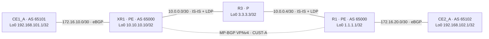

# LAB 01 — L3VPN MPLS entre Cisco IOS e IOS XR

## Resultado

**L3VPN CUST-A validada em 13/11/2026, às 15:43 (America/Sao_Paulo): comunicação bidirecional entre as loopbacks dos dois sites, com 20/20 respostas em cada sentido.** IS-IS, LDP, MP-BGP VPNv4 e eBGP PE–CE estavam operacionais. Não foi necessário corrigir ou aplicar configuração de rede. Os equipamentos reservados à futura L2VPN não foram configurados nem renomeados.

Este laboratório comprova conectividade IPv4 entre dois sites da mesma VRF. Não inclui teste de isolamento entre clientes, convergência após falha, MTU máxima, desempenho ou L2VPN.

## Objetivo e hipótese

Transportar os prefixos `192.168.101.1/32` e `192.168.102.1/32` por um backbone MPLS sem instalá-los na tabela IP do roteador P. A hipótese é que a conectividade exige quatro elementos coerentes: alcance IP entre os PEs, transporte MPLS, distribuição das rotas VPNv4 e importação dessas rotas na VRF correta.

## Topologia e recursos

Topologia lógica reconstruída a partir das configurações, adjacências e traceroutes coletados. O arquivo `.unl` não foi exportado nesta validação.



| Equipamento | Função | Plataforma observada | Interfaces utilizadas |
|---|---|---|---|
| CE1_A | CE do site 1 | Cisco IOS 15.2 | Fa0/0 `172.16.10.1/30`; Lo0 `192.168.101.1/32` |
| XR1 | PE do site 1 | IOS XR 6.3.1 | Gi0/0/0/0 `172.16.10.2/30` na VRF; Gi0/0/0/2 `10.0.0.1/30`; Lo0 `10.10.10.10/32` |
| R3 | P do backbone | Cisco IOS 15.2 | Fa1/0 `10.0.0.2/30`; Fa0/0 `10.0.0.5/30`; Lo0 `3.3.3.3/32` |
| R1 | PE do site 2 | Cisco IOS 15.2 | Fa2/0 `10.0.0.6/30`; Fa3/0 `172.16.20.1/30` na VRF; Lo0 `1.1.1.1/32` |
| CE2_A | CE do site 2 | Cisco IOS 15.2 | Fa0/0 `172.16.20.2/30`; Lo0 `192.168.102.1/32` |

Os endereços acima são os valores efetivamente observados no laboratório. `1.1.1.1` e `3.3.3.3` não são faixas reservadas para documentação: foram usados como loopbacks internas deste ambiente e não devem ser anunciados para a Internet.

## Como a VPN funciona neste lab

1. CE1_A anuncia sua loopback ao XR1 por eBGP. CE2_A faz o mesmo para R1.
2. Cada PE aprende a rota local dentro de `CUST-A` e a exporta por MP-BGP VPNv4 para o outro PE.
3. Ambos usam RD `65000:100` e RT de importação/exportação `65000:100`. O **RD distingue prefixos VPNv4; o RT controla a importação na VRF**. Usar o mesmo valor numérico não torna suas funções iguais.
4. IS-IS nível 2 fornece alcance entre as loopbacks dos PEs. LDP fornece os labels de transporte.
5. O PE de entrada impõe labels de transporte e de VPN. R3 encaminha por MPLS; o PE de saída entrega o pacote ao CE correto. O P não precisa carregar as rotas dos clientes. Essa separação é descrita na [RFC 4364](https://www.rfc-editor.org/rfc/rfc4364.html).

No XR, a política `PASS` está aplicada em entrada e saída ao vizinho CE na família IPv4 da VRF. No R1, `send-community extended` está configurado para o vizinho VPNv4. Esses pontos fazem parte da configuração observada, não foram adicionados nesta execução.

## Configurações preservadas

As configurações completas estão em [configs/LAB01-L3VPN-2026-11-13](configs/LAB01-L3VPN-2026-11-13/).

| Equipamento | Situação constatada |
|---|---|
| CE1_A, CE2_A, R1 e R3 | `running-config` e `startup-config` coletadas; comandos efetivos equivalentes ao desconsiderar comentários e cabeçalhos |
| XR1 | `running-config` coletada e histórico de commits consultado; último commit listado `1000000019`, em 22/09/2026 |

Nenhuma restauração, `write memory`, `copy running-config startup-config`, alteração de configuração ou reboot foi realizado nesta validação. Apenas a paginação da sessão foi desativada para coleta. O histórico do XR é evidência de commits existentes; não foi executado teste de persistência por reinicialização.

## Roteiro de validação e resultados

| Camada | Verificação | Resultado observado |
|---|---|---|
| Interfaces | Interfaces de acesso e backbone | Up/up nos links utilizados |
| IGP | IS-IS XR1–R3 e R3–R1 | Adjacências nível 2 Up |
| Transporte | Vizinhanças LDP | Oper nos dois enlaces do backbone |
| VPN | MP-BGP entre `10.10.10.10` e `1.1.1.1` | Established, um prefixo remoto recebido por PE |
| Acesso | eBGP CE1_A–XR1 e CE2_A–R1 | Established, um prefixo remoto recebido por CE |
| VRF | Tabelas `CUST-A` | As duas loopbacks presentes em ambos os PEs |
| Encaminhamento | CEF/LFIB e traceroute | Labels VPN e transporte coerentes |
| Dados | CE1_A → CE2_A | 100%, 20/20; RTT mínimo/médio/máximo 12/33/56 ms |
| Dados | CE2_A → CE1_A | 100%, 20/20; RTT mínimo/médio/máximo 32/62/80 ms |
| Separação de tabelas | Tabelas globais dos PEs e R3 | Prefixos das loopbacks dos clientes ausentes das tabelas globais coletadas |

A ausência dos prefixos do cliente no backbone é coerente com a arquitetura; não substitui um teste de isolamento entre duas VRFs, que não foi realizado.

### Testes de dados executados

No CE1_A:

```text
ping 192.168.102.1 source 192.168.101.1 repeat 20 timeout 2
Success rate is 100 percent (20/20), round-trip min/avg/max = 12/33/56 ms
```

No CE2_A:

```text
ping 192.168.101.1 source 192.168.102.1 repeat 20 timeout 2
Success rate is 100 percent (20/20), round-trip min/avg/max = 32/62/80 ms
```

Usar a loopback como origem valida o caminho de ida **e a rota de retorno dos prefixos anunciados pelos CEs**. Um ping com origem automática na interface de acesso testaria outro par de endereços.

### Labels vistos no caminho

CE1_A → CE2_A:

```text
1 172.16.10.2 8 msec
2 10.0.0.2 [MPLS: Labels 16/18 Exp 0] 40 msec
3 172.16.20.1 [MPLS: Label 18 Exp 0] 40 msec
4 172.16.20.2 32 msec
```

CE2_A → CE1_A:

```text
1 172.16.20.1 24 msec
2 10.0.0.5 [MPLS: Labels 17/24003 Exp 0] 56 msec
3 10.0.0.1 [MPLS: Label 24003 Exp 0] 56 msec
4 172.16.10.1 84 msec
```

O CEF do XR1 mostrou `labels imposed {16 18}` para `192.168.102.1/32`. No R1, o CEF mostrou label VPN `24003` e label de transporte `17` para `192.168.101.1/32`. A LFIB de R3 mostrou `Pop Label` para as loopbacks dos PEs, compatível com PHP. Esses números são locais e dinâmicos; podem mudar após reinicialização ou reconvergência.

O último salto aparece com o endereço da interface do CE, embora o destino consultado seja sua loopback. Não confundir o endereço usado na resposta ICMP com mudança do destino do teste.

## Comandos de diagnóstico

| Pergunta | IOS | IOS XR |
|---|---|---|
| Interface está ativa? | `show ip interface brief` | `show ipv4 interface brief` |
| IGP formou vizinhança? | `show isis neighbors` | `show isis adjacency` |
| Transporte MPLS está pronto? | `show mpls ldp neighbor` | `show mpls ldp neighbor` |
| Sessão VPNv4 está estabelecida? | `show ip bgp vpnv4 all summary` | `show bgp vpnv4 unicast summary` |
| Rotas chegaram à VRF? | `show ip route vrf CUST-A` | `show route vrf CUST-A` |
| Qual label será imposto? | `show ip cef vrf CUST-A 192.168.101.1 detail` | `show cef vrf CUST-A 192.168.102.1 detail` |
| Como o backbone encaminha? | `show mpls forwarding-table` | `show mpls forwarding` |

## Se parar de funcionar

1. Confira interfaces e endereçamento PE–CE e no backbone.
2. Confira IS-IS e alcance às loopbacks dos PEs.
3. Confira LDP e LFIB. BGP estabelecido sozinho não comprova transporte MPLS funcional.
4. Confira eBGP PE–CE, anúncio das loopbacks e política `PASS` no XR.
5. Confira VPNv4, RTs e presença da rota remota dentro de `CUST-A`.
6. Confira CEF e execute ping com origem explícita na loopback.

Não remova RTs, derrube interfaces ou limpe sessões para reproduzir falhas sem um plano separado. Nesta execução não houve injeção de falhas.

## Diagnóstico da suspeita de perda de configuração

A suspeita de perda geral não se confirmou na parte L3VPN. Os quatro equipamentos IOS tinham configuração ativa e salva. O XR1 também tinha configuração e commits existentes. A primeira tentativa de coleta do XR não chegava ao prompt; ajustar a interação do console para envio de CR permitiu consultar o equipamento. Não há evidência de que a configuração do XR tenha sido restaurada ou recriada nesta sessão.

Os dois consoles que apresentaram assistente inicial foram excluídos desta etapa conforme a orientação de preservar os equipamentos L2 para outro laboratório.

## Evidências e limites

- [Saídas completas dos cinco equipamentos](evidencias/LAB01-L3VPN-2026-11-13/): comandos, respostas e horário local do início da coleta por dispositivo.
- [Manifesto SHA-256](evidencias/LAB01-L3VPN-2026-11-13/SHA256SUMS.txt): integridade dos arquivos publicados de configuração e evidência.
- [Revisão rápida no Notion](https://app.notion.com/p/41601f76d92881b6a737c04816a2a214).

As evidências publicadas passaram por revisão de dados sensíveis. Endereço de gerenciamento do EVE-NG, portas de console e credenciais de acesso não fazem parte do pacote. Foram preservados os endereços e ASNs do cenário para permitir reprodução. Logs intermediários de descoberta não são a evidência final.

**Conclusão:** a L3VPN entre CE1_A e CE2_A estava funcional e foi validada sem mudanças de configuração. O resultado cobre conectividade bidirecional dos dois prefixos testados na condição observada, não disponibilidade após falha nem todos os possíveis serviços de uma VPN.
