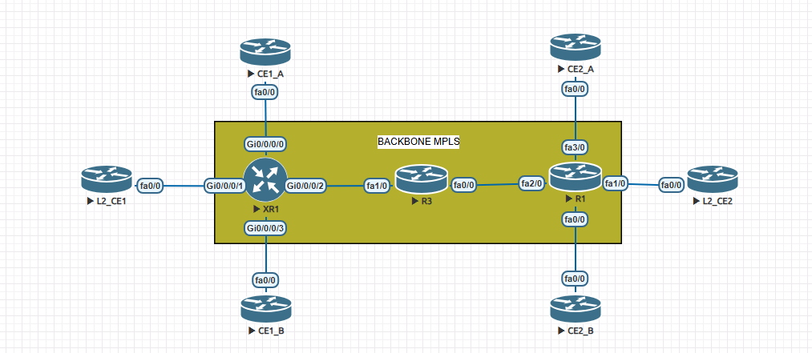
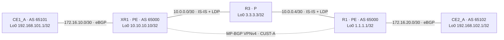

# LAB 01 — MPLS L3VPN Between Cisco IOS and IOS XR

## Result and validation boundary

**CUST-A passed bidirectional loopback-to-loopback testing on 2026-11-13 at 15:43, America/Sao_Paulo: 20/20 ICMP replies in each direction.** IS-IS, LDP, MP-BGP VPNv4 and PE–CE eBGP were already operational. No network configuration change was necessary.

The tested path is **CE1_A–XR1–R3–R1–CE2_A**. A subsequently supplied screenshot also shows CE1_B/CE2_B; those devices were not checked in the five-device collection. L2_CE1/L2_CE2 were reserved for future L2VPN work and were not configured or renamed.

## Actual topology screenshot



Original user-supplied image, received on 2026-11-13 and published unchanged. It shows the full canvas, including unverified/reserved nodes. Interface labels agree with the tested CUST-A path. The image is not proof that every node is configured or running.

### Validated logical path



The diagram is reconstructed from configuration and operational output; it is not an exported .unl file.

## Addressing and roles

| Device | Role / platform | Used interfaces |
|---|---|---|
| CE1_A | Customer edge, IOS 15.2 | Fa0/0 172.16.10.1/30; Lo0 192.168.101.1/32 |
| XR1 | Provider edge, IOS XR 6.3.1 | Gi0/0/0/0 172.16.10.2/30 in CUST-A; Gi0/0/0/2 10.0.0.1/30; Lo0 10.10.10.10/32 |
| R3 | Provider core, IOS 15.2 | Fa1/0 10.0.0.2/30; Fa0/0 10.0.0.5/30; Lo0 3.3.3.3/32 |
| R1 | Provider edge, IOS 15.2 | Fa2/0 10.0.0.6/30; Fa3/0 172.16.20.1/30 in CUST-A; Lo0 1.1.1.1/32 |
| CE2_A | Customer edge, IOS 15.2 | Fa0/0 172.16.20.2/30; Lo0 192.168.102.1/32 |

These are observed lab values. 1.1.1.1 and 3.3.3.3 are not documentation prefixes; keep them inside the isolated lab and do not advertise them externally.

## How the service works

1. CE1_A advertises its loopback by eBGP to XR1. CE2_A advertises its loopback to R1.
2. Each PE stores its local customer route in CUST-A and exports a VPNv4 route to the other PE.
3. Both PEs use RD 65000:100 and import/export RT 65000:100. **RD distinguishes VPNv4 prefixes; RT governs VRF import.** Equal numeric values do not make their roles interchangeable.
4. IS-IS level 2 provides reachability between PE loopbacks. LDP supplies transport labels.
5. The ingress PE imposes transport and VPN labels. R3 forwards MPLS without carrying customer routes; the egress PE delivers toward its CE. See [RFC 4364](https://www.rfc-editor.org/rfc/rfc4364.html).

## Configuration decisions and why they matter

Full snapshots are in [configs/LAB01-L3VPN-2026-11-13](configs/LAB01-L3VPN-2026-11-13/). The following are existing excerpts, not changes applied during validation.

### R1: separate customer routing and distribute VPN routes

```cisco
ip vrf CUST-A
 rd 65000:100
 route-target export 65000:100
 route-target import 65000:100
!
interface FastEthernet3/0
 ip vrf forwarding CUST-A
 ip address 172.16.20.1 255.255.255.252
!
router bgp 65000
 neighbor 10.10.10.10 remote-as 65000
 neighbor 10.10.10.10 update-source Loopback0
 address-family vpnv4
  neighbor 10.10.10.10 activate
  neighbor 10.10.10.10 send-community extended
 exit-address-family
 address-family ipv4 vrf CUST-A
  neighbor 172.16.20.2 remote-as 65102
  neighbor 172.16.20.2 activate
 exit-address-family
```

The access interface belongs to the customer VRF. The VPNv4 session uses stable loopbacks. Extended communities carry the RT information needed for import. The CE neighbor is activated inside the customer address family.

### XR1: accept and advertise the customer routes

```cisco
route-policy PASS
  pass
end-policy
!
router bgp 65000
 vrf CUST-A
  rd 65000:100
  address-family ipv4 unicast
  !
  neighbor 172.16.10.1
   remote-as 65101
   address-family ipv4 unicast
    route-policy PASS in
    route-policy PASS out
```

The captured XR configuration applies PASS in both directions to the CE. Its VRF configuration imports/exports RT 65000:100. A working PE-to-PE session alone does not replace the customer-facing policy and route exchange.

### Core transport

R1/R3 use IS-IS CORE, level-2-only, wide metrics and mpls ldp autoconfig. XR1 uses the corresponding IS-IS IPv4 address-family mpls ldp auto-config. Loopbacks are passive in IS-IS and serve as LDP router IDs.

**IS-IS L2 means IGP level 2, not L2VPN.** R3 has no customer VRF/BGP requirement for this transport role.

## Verification: command → observation → explanation

| Layer | Command examples | Observed outcome | Why it matters |
|---|---|---|---|
| Interfaces | show ip interface brief / show ipv4 interface brief | Used links Up/up | Establishes the basic access/core path |
| IGP | show isis neighbors / show isis adjacency | XR1–R3 and R3–R1 Up | PE-loopback reachability can be resolved |
| Transport | show mpls ldp neighbor | Oper on both core links | LDP sessions have formed |
| VPN control | show ip bgp vpnv4 all summary / show bgp vpnv4 unicast summary | Established; one remote customer prefix per PE | The VPN route exchange is active |
| Access | show ip bgp summary / show bgp vrf CUST-A ipv4 unicast summary | CE sessions Established | Each site exchanges routes with its PE |
| VRF RIB | show ip route vrf CUST-A / show route vrf CUST-A | Both customer /32s installed | Imported routes are usable in the customer table |
| Forwarding | CEF detail and MPLS forwarding tables | VPN and transport labels resolved | The route has a concrete forwarding action |
| Data | Loopback-sourced pings in both directions | 20/20 each way | The tested customer prefixes have working forward/return paths |

Customer loopbacks were absent from the global routing tables collected on the PEs and R3. This is consistent with the service model, but is not a multi-VRF isolation test.

## Measured traffic results

On CE1_A:

```text
ping 192.168.102.1 source 192.168.101.1 repeat 20 timeout 2
Success rate is 100 percent (20/20), round-trip min/avg/max = 12/33/56 ms
```

On CE2_A:

```text
ping 192.168.101.1 source 192.168.102.1 repeat 20 timeout 2
Success rate is 100 percent (20/20), round-trip min/avg/max = 32/62/80 ms
```

The explicit source forces a return path to the advertised customer loopback. A ping sourced automatically from an access interface would test a different address pair. These short runs are connectivity checks, not throughput or latency benchmarks.

### Trace the label stack

CE1_A to CE2_A:

```text
traceroute 192.168.102.1 source 192.168.101.1 numeric timeout 1 probe 1
1 172.16.10.2 8 msec
2 10.0.0.2 [MPLS: Labels 16/18 Exp 0] 40 msec
3 172.16.20.1 [MPLS: Label 18 Exp 0] 40 msec
4 172.16.20.2 32 msec
```

CE2_A to CE1_A:

```text
traceroute 192.168.101.1 source 192.168.102.1 numeric timeout 1 probe 1
1 172.16.20.1 24 msec
2 10.0.0.5 [MPLS: Labels 17/24003 Exp 0] 56 msec
3 10.0.0.1 [MPLS: Label 24003 Exp 0] 56 msec
4 172.16.10.1 84 msec
```

XR1 CEF reported labels imposed {16 18} for 192.168.102.1/32. R1 CEF reported VPN label 24003 and transport label 17 for 192.168.101.1/32. R3's LFIB showed Pop Label for the PE loopbacks, consistent with penultimate-hop popping. The remaining VPN label is still relevant at the egress PE.

Labels are local/dynamic values and may change. The final traceroute response uses the CE access address even though the tested destination is its loopback; an ICMP response address does not redefine the requested destination.

## Troubleshooting order

1. Check the physical/interface state and addressing.
2. Check IS-IS and reachability to both PE loopbacks.
3. Check LDP and the LFIB. Established BGP alone does not prove transport forwarding.
4. Check CE advertisements and XR's customer route policy.
5. Check VPNv4, RTs and the remote prefix inside CUST-A.
6. Inspect CEF recursion and repeat a bounded loopback-sourced ping.

Useful forwarding checks:

```cisco
! R1:
show ip bgp vpnv4 all labels
show ip cef vrf CUST-A 192.168.101.1 detail
show mpls forwarding-table
! XR1:
show cef vrf CUST-A 192.168.102.1 detail
show mpls forwarding
```

No interface shutdown, session reset or fault injection was performed in this validation.

## Configuration preservation and diagnosis

R1, R3, CE1_A and CE2_A had matching effective running/startup commands after excluding comments and headers. XR1 had an active configuration and an existing commit history; latest listed commit 1000000019 was dated 2026-09-22.

The suspected general configuration loss was not confirmed for the five-device CUST-A path. The initial XR console collector did not reach the prompt; sending CR allowed inspection. No XR configuration was recreated or restored.

Only session pagination was disabled for capture. There was no write memory, copy running-config startup-config, new XR commit, reboot or persistence-through-reboot test.

## Evidence and limits

- [Reviewed command outputs](evidencias/LAB01-L3VPN-2026-11-13/): actual commands/responses, with per-device local collection time.
- [Configuration snapshots](configs/LAB01-L3VPN-2026-11-13/).
- [SHA-256 manifest](evidencias/LAB01-L3VPN-2026-11-13/SHA256SUMS.txt): current published configuration/evidence bytes.
- [Portuguese personal revision note in Notion](https://app.notion.com/p/41601f76d92881b6a737c04816a2a214).

The English rewrite translates editorial headers, not device responses. EVE management addresses, console ports and access credentials are excluded from this package.

**Conclusion:** the two CUST-A loopbacks communicated bidirectionally in the observed condition without configuration changes. Customer B, inter-VRF isolation, convergence after failure, maximum MTU, performance and L2VPN remain outside the validated scope.
