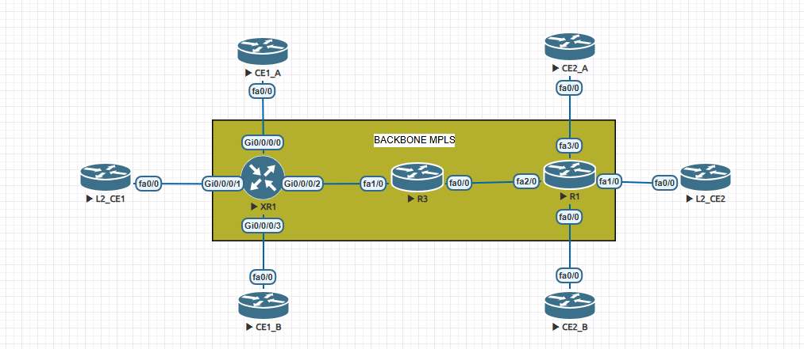

# LAB 01 — MPLS L3VPN with IOS and IOS XR

**My goal:** check whether two customer sites could communicate over an MPLS core without putting customer routes in the global provider table.



## My topology

```text
CE1_A -- XR1 (PE) -- R3 (P) -- R1 (PE) -- CE2_A
          IOS XR      IOS        IOS
          AS 65000                 AS 65000
```

I used VRF **CUST-A**, RD `65000:100` and RT import/export `65000:100`. CE1_A had loopback `192.168.101.1/32`; CE2_A had `192.168.102.1/32`.

## How I built the service

1. **PE–CE eBGP** exchanges each customer's prefixes.
2. **MP-BGP VPNv4** carries the VPN routes between XR1 and R1.
3. **RD** makes VPNv4 routes unique; **RT** decides which VRF imports them.
4. **IS-IS + LDP** provide PE-to-PE transport through R3.
5. The ingress PE imposes a transport label and a VPN label; the P router switches labels, not customer VRF routes.

The service was already configured when I tested it; **I did not change any router configuration**.

## What I verified (2026-11-13)

| Check | My observation |
|---|---|
| IS-IS / LDP | Core adjacencies operational |
| CE eBGP and PE VPNv4 | Established; remote customer prefixes received |
| VRF CUST-A | Customer loopbacks installed on both PEs |
| CE1_A → CE2_A | **20/20**, RTT 12/33/56 ms |
| CE2_A → CE1_A | **20/20**, RTT 32/62/80 ms |
| MPLS forwarding | CEF and traceroute showed transport + VPN labels |

A sample of my forward-path traceroute:

```text
CE1_A -> CE2_A
1 172.16.10.2
2 10.0.0.2 [MPLS: Labels 16/18]
3 172.16.20.1 [MPLS: Label 18]
4 172.16.20.2
```

The first label transports the packet through the core; the VPN label identifies the service at the egress PE. **MPLS label values are local/dynamic.**

```cisco
! IOS PE:
show ip bgp vpnv4 all summary
show ip route vrf CUST-A
show ip cef vrf CUST-A 192.168.101.1 detail
show mpls forwarding-table
! XR PE:
show bgp vpnv4 unicast summary
show route vrf CUST-A
show mpls forwarding
```

## What I learned

**A working BGP session does not prove a working VPN.** I checked the CE routes, VPNv4 import, transport labels and traffic in **both directions**. The customer routes were absent from the collected global tables, as expected.

**Limit:** I tested only CUST-A, not customer B, inter-VRF isolation, MTU or fault recovery. Running/startup matched on the collected IOS devices; XR1 had commit history, but I did not test persistence after a reboot.

**Evidence:** [Original CLI](evidencias/LAB01-L3VPN-2026-11-13/) · [Collected configs](configs/LAB01-L3VPN-2026-11-13/) · [Checksums](evidencias/LAB01-L3VPN-2026-11-13/SHA256SUMS.txt).
