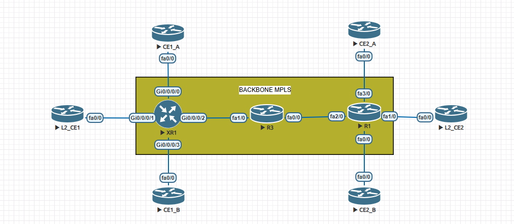

# MPLS, L3VPN and Traffic Engineering

## Documented lab

| Lab | Scope | Recorded result |
|---|---|---|
| [LAB 01 — IOS / IOS XR L3VPN](LAB01-L3VPN-ISIS-LDP-IOS-XR.md) | IS-IS, LDP, VPNv4, VRF, eBGP PE–CE | CUST-A: 20/20 replies in each direction on 2026-11-13 |

**Validated:** CE1_A–XR1–R3–R1–CE2_A. **Not verified in this capture:** CE1_B/CE2_B. **Reserved:** L2_CE1/L2_CE2 for a future L2VPN lab.

## Read the forwarding chain

IS-IS provides PE-loopback reachability. LDP builds label-switched transport. MP-BGP carries customer VPN routes between PEs. The RT controls VRF import. CEF/LFIB and source-specific pings test whether those layers combine into an actual data path.

The lab guide maps each command to the question it answers, explains the observed label stack, and links the snapshots and raw output.

## Planned scope

LDP-IGP synchronization, RSVP-TE, traffic-engineered paths and fast reroute are future topics. The existing L3VPN result does not validate those mechanisms.

- [x] First lab documented with direct command evidence
- [x] Configuration and control/data-plane review for CUST-A
- [ ] Controlled failure and recovery exercise
- [ ] RSVP-TE / FRR validation

Use reviewed lab addressing and exclude credentials or production data from every new publication.
