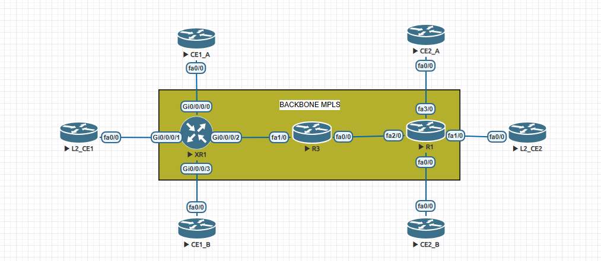

# MPLS, L3VPN and Traffic Engineering

## Documented lab

| Lab | Scope | Recorded result |
|---|---|---|
| [LAB 01 — IOS / IOS XR L3VPN](LAB01-L3VPN-ISIS-LDP-IOS-XR.md) | IS-IS, LDP, VPNv4, VRF, eBGP PE–CE | CUST-A: 20/20 replies in each direction on 2026-11-13 |
| [LAB 06 — L2VPN VPWS / EoMPLS](LAB06-L2VPN-VPWS-IOS-IOSXR.md) | IS-IS + LDP transport, targeted LDP PW 100, Ethernet between CEs | R2/R1 IOS PW UP; CE pings 9/10 and 10/10; 65 received/77 sent, no drops on R2; XRv classic limitation observed |

**L3VPN validated:** CE1_A–XR1–R3–R1–CE2_A. **L2VPN LAB06 validated:** L2_CE1–R2–R3–R1–L2_CE2. **Not verified:** CE1_B/CE2_B. The screenshot reflects an earlier topology before R2 was added.

## Read the forwarding chain

IS-IS provides PE-loopback reachability. LDP builds label-switched transport. MP-BGP carries customer VPN routes between PEs. The RT controls VRF import. CEF/LFIB and source-specific pings test whether those layers combine into an actual data path.

The lab guide maps each command to the question it answers, explains the observed label stack, and links the snapshots and raw output.

## LAB 06 — VPWS evidence and configuration

- [Complete step-by-step VPWS guide](LAB06-L2VPN-VPWS-IOS-IOSXR.md)
- [Six real running-config snapshots (14 Nov 2026)](configs/LAB06-VPWS-2026-11-14/)
- [Observed CLI and startup-state evidence](evidencias/LAB06-VPWS-2026-11-14/)
- The L2_CE1/L2_CE2 running configs were captured, but persistence to startup was **not** verified. R1/R2/R3 startup matches running. XR1 final config no longer contains the early experimental xconnect.

## Planned scope

LDP-IGP synchronization, RSVP-TE, traffic-engineered paths and fast reroute are future topics. The existing L3VPN result does not validate those mechanisms.

- [x] First lab documented with direct command evidence
- [x] Configuration and control/data-plane review for CUST-A
- [x] L2VPN VPWS on IOS: control plane, bidirectional CE forwarding and saved R1/R2/R3 configurations
- [ ] Controlled failure and recovery exercise
- [ ] RSVP-TE / FRR validation

Use reviewed lab addressing and exclude credentials or production data from every new publication.
