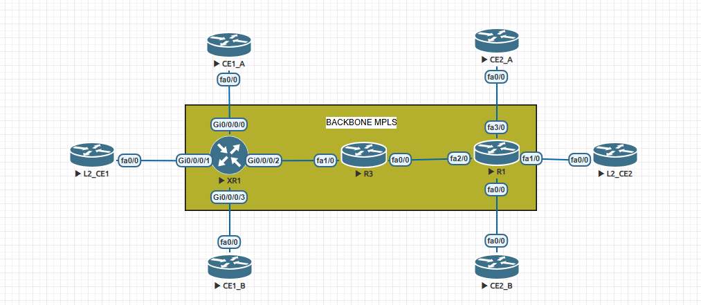

# My Original MPLS Topology Screenshot

I captured this image for the **L3VPN** setup, where I tested **CE1_A → XR1 → R3 → R1 → CE2_A**.

CE1_B/CE2_B appear in the canvas but were **not validated**. Later VPWS/VPLS and Traffic Engineering labs use their own topologies; R2 was added after this screenshot.

This image shows the intended layout, **not proof that every router or service was operational**.

[My L3VPN test](../LAB01-L3VPN-ISIS-LDP-IOS-XR.md) · [Device evidence](../evidencias/LAB01-L3VPN-2026-11-13/).
