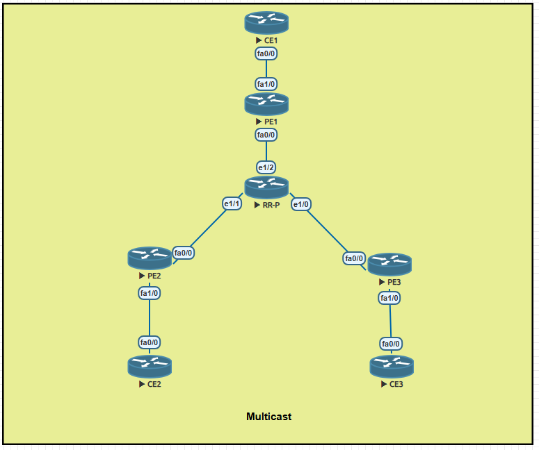
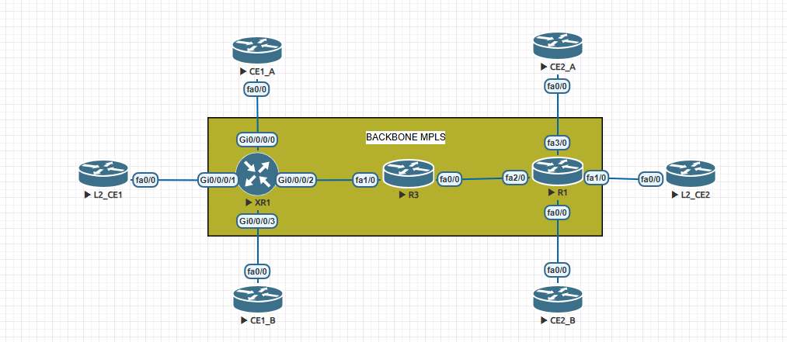

# My CCNP / CCIE Service Provider Labs

I use this repository to document **what I configured, what I tested, what I observed and what I learned** in EVE-NG. Each lab links to the real CLI evidence and configuration backups.

## Completed labs

| Lab | What I learned | Result I recorded |
|---|---|---|
| [01 — PIM-SM / ASM](01-Multicast/LAB01-PIM-SM-ASM.md) | How receivers build `(*,G)` toward an RP | IGMP, RPF and SPT state; no comparable receiver counters |
| [02 — SSM / IGMPv3](01-Multicast/LAB02-PIM-SSM-IGMPv3.md) | Why the chosen source matters | Distinct `(S,G)` channels; PE2 counter **26→28** |
| [03 — BIDIR PIM](01-Multicast/LAB03-PIM-BIDIR.md) | How one shared tree handles multiple sources | DF election; tree counter **14→17** |
| [04 — Anycast RP / MSDP](01-Multicast/LAB04-Anycast-RP-MSDP.md) | What survives an RP loopback failure | MSDP/SA, RP route change and known-source forwarding |
| [05 — IPv6 multicast](01-Multicast/LAB05-IPv6-Multicast.md) | ASM vs SSM with MLDv2 | Two receivers, source-selection positive/negative tests |
| [L3VPN — IOS / XR](02-MPLS-TE/LAB01-L3VPN-ISIS-LDP-IOS-XR.md) | VRF + VPNv4 + MPLS labels | **20/20** CE pings each way |
| [06 — VPWS](02-MPLS-TE/LAB06-L2VPN-VPWS-IOS-IOSXR.md) | PW signaling vs real Ethernet delivery | IOS PW UP; CE pings **9/10** and **10/10** |
| [07 — VPLS + VPWS spoke](02-MPLS-TE/LAB07-VPLS-CSR1000v-VPWS-C7200.md) | Bridge-domain and remote MAC learning | All **12 directed CE pairs** reached 10/10 |
| [08 — RSVP-TE](02-MPLS-TE/LAB08-MPLS-RSVP-TE-ISIS-AUTOROUTE.md) | Explicit path, Autoroute and RSVP reservation | R1→R3→R4; bandwidth **1→5→1 Mbps** |
| [09 — RSVP-TE FRR](02-MPLS-TE/LAB09-MPLS-TE-FRR-NNHOP-IOS.md) | Local NNHOP repair | **Ready→Active→Ready**; backup ping 5/5 |
| [10 — CSPF / Preemption](02-MPLS-TE/LAB10-MPLS-TE-CSPF-AFFINITY-PREEMPTION-IOS.md) | Cost, bandwidth, affinity and priority | Measured path changes, preemption syslog and recovery |
| [11 — SR-MPLS](03-Segment-Routing/LAB11-SR-MPLS-ISIS-IOSXR.md) | Prefix-SIDs, Adj-SIDs and MPLS LFIB | Two XRv; labels programmed and pings **5/5** each way |

## My topologies

**Multicast:** seven-router physical tree (CE1 → PE1 → RR-P → PE2/PE3 → CE2/CE3).

**MPLS:** the screenshot shows my original L3VPN canvas. Later VPWS, VPLS and TE labs use separate or expanded topologies; each guide identifies its own setup.

## Where I keep the details

- [Multicast](01-Multicast/) · [MPLS / VPN / TE](02-MPLS-TE/) · [Segment Routing](03-Segment-Routing/) · [Automation](09-Automation/)
- Planned: [EVPN/VXLAN](04-EVPN-VXLAN/), [QoS](05-QoS/), [BGP](06-BGP-Advanced/), [High Availability](07-High-Availability/), [Security](08-Security/), [IPv6](10-IPv6/) and [Troubleshooting](11-Troubleshooting/).
- [Template for my next lab](LAB-TEMPLATE.md) · [Documentation history](CHANGELOG.md)

**My rule:** configuration ≠ control-plane operation ≠ packet delivery. I report these separately, keep failed tests and limitations visible, and never publish secrets or unreviewed production data.

My explanations are in English. Router commands and captured outputs retain their original syntax. This is my independent study notebook, not an official Cisco course.
