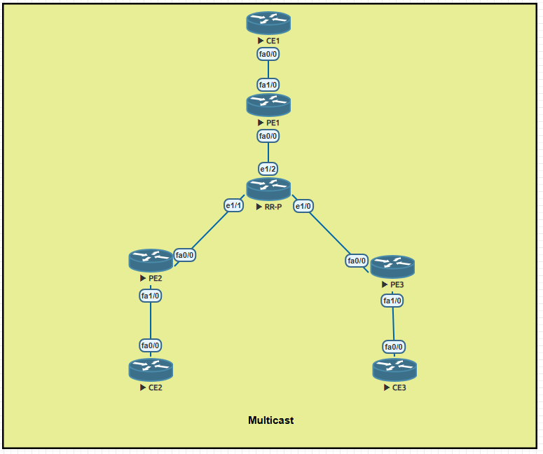
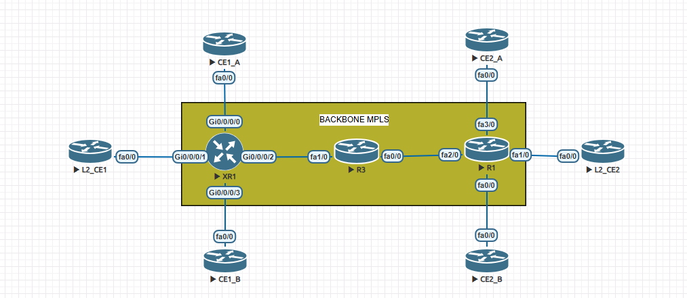

# CCNP / CCIE Advanced Networking Labs

Hands-on Cisco IOS and IOS XR labs with topology screenshots, configuration snapshots, command output, and explanations of **what happened and why**.

## Start with the documented labs

| Lab | Main question | Evidence and limits |
|---|---|---|
| [PIM-SM / ASM](01-Multicast/LAB01-PIM-SM-ASM.md) | How do receivers discover a source through an RP? | IGMP, shared/source state, RPF and IOS SPT flag; receiver delivery counters were not captured |
| [SSM / IGMPv3](01-Multicast/LAB02-PIM-SSM-IGMPv3.md) | How does a receiver select a specific source? | Source-specific trees and PE2 forwarding counters |
| [Bidirectional PIM](01-Multicast/LAB03-PIM-BIDIR.md) | How can multiple sources share one tree? | DF election and increasing shared-tree counters; no separately labeled per-source counter runs |
| [Anycast RP / MSDP](01-Multicast/LAB04-Anycast-RP-MSDP.md) | What survives an RP address failure? | RP route change, SA state and forwarding of a known source; no new-source-after-failure test |
| [IPv6 multicast](01-Multicast/LAB05-IPv6-Multicast.md) | How do ASM, SSM and MLDv2 interact? | Positive/negative source tests and receiver replies; MLDv1 not tested |
| [MPLS L3VPN: IOS / IOS XR](02-MPLS-TE/LAB01-L3VPN-ISIS-LDP-IOS-XR.md) | How does a VPN cross a core without customer routes? | CUST-A: 20/20 ICMP replies in each direction, VPNv4, CEF and MPLS labels |

## Topology gallery

### Multicast: seven-router tree

CE1 is the source-side router; CE2 and CE3 are receiver-side routers. RR-P is the central transit/RP router. Its name does not mean that BGP route reflection is configured.

### MPLS: complete canvas, limited validation scope

The L3VPN evidence covers **CE1_A–XR1–R3–R1–CE2_A**. CE1_B and CE2_B are visible but were not verified in that collection. L2_CE1 and L2_CE2 are reserved for a future L2VPN lab. A screenshot establishes layout, not operational status.

## How to read a lab

1. Read the objective and topology to identify the intended traffic path.
2. Review the configuration excerpts and what each command enables.
3. Run the verification commands on the stated platform.
4. Compare the actual output with the interpretation and evidence limits.
5. Follow the troubleshooting sequence before changing configuration.

**Configured**, **control plane established**, and **traffic delivered** are different claims. A configuration file alone does not prove forwarding. Historical captures are not fresh tests.

## Study roadmap

| Folder | Scope | Current material |
|---|---|---|
| [01-Multicast](01-Multicast/) | ASM, SSM, BIDIR, Anycast RP, IPv6 multicast | Five documented labs |
| [02-MPLS-TE](02-MPLS-TE/) | MPLS forwarding, L3VPN, LDP, TE, FRR | One validated CUST-A L3VPN lab |
| [03-Segment-Routing](03-Segment-Routing/) | SR-MPLS, SR-TE, TI-LFA, SRv6 | Planned study |
| [04-EVPN-VXLAN](04-EVPN-VXLAN/) | EVPN, VXLAN, IRB, multihoming | Planned study |
| [05-QoS](05-QoS/) | Classification, queues, WRED, shaping, policing | Planned study |
| [06-BGP-Advanced](06-BGP-Advanced/) | RR, Add-Path, PIC, RPKI, policy | Planned study |
| [07-High-Availability](07-High-Availability/) | BFD, VRRP, LACP, MSTP | Planned study |
| [08-Security](08-Security/) | CoPP, uRPF, DAI, ACLs, AAA | Planned study |
| [09-Automation](09-Automation/) | Python, NETCONF/YANG, RESTCONF, Ansible | IOS console backup utility |
| [10-IPv6](10-IPv6/) | IPv6 routing, multicast, ND, PMTUD | Link to multicast LAB 05 |
| [11-Troubleshooting](11-Troubleshooting/) | Structured diagnosis and fault isolation | Method and future integrated exercise |

Use [LAB-TEMPLATE.md](LAB-TEMPLATE.md) for new labs. Planned topics are not presented as completed tests.

## Evidence, language and publication policy

Documentation and editorial annotations are in English. Device CLI output and configuration commands retain their original meaning. The legacy paths `evidencias/`, `comandos.md` and `enderecamento.md` remain stable so existing links keep working; their contents are documented in English.

Only reviewed lab material belongs in this public repository. Never upload credentials, private keys, production/customer data, VM images, or an unreviewed backup directory. Addresses shown are the values used inside these isolated labs; some IPv4 loopbacks are not documentation prefixes and must not be advertised externally.

The English editorial revision adds explanations and screenshots; it does **not** represent a new execution of every historical lab. See [CHANGELOG.md](CHANGELOG.md) for the scope of the revision.

This is an independent study project, not an official Cisco training course.
